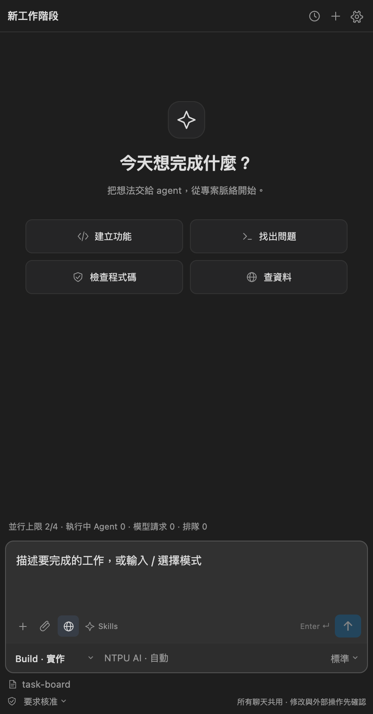
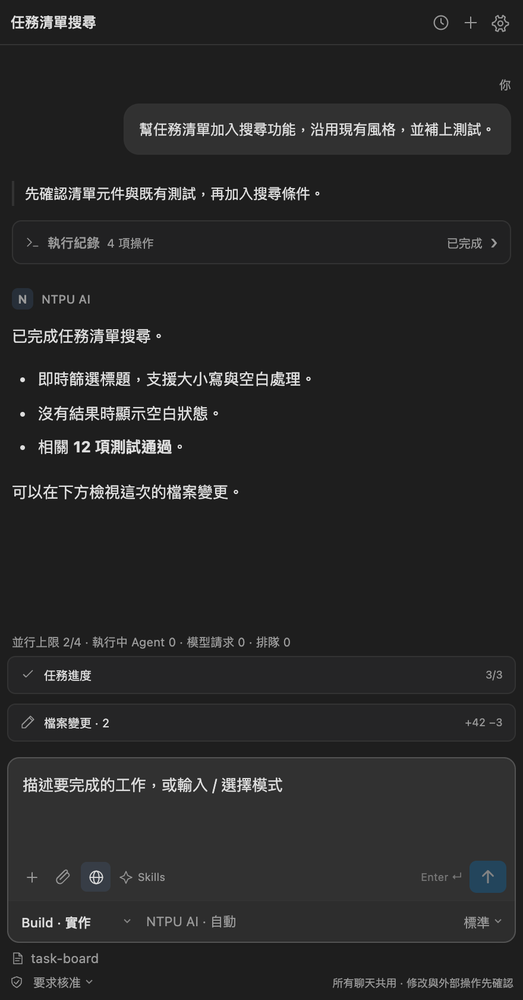

# NTPU AI Agent

在 VS Code 中使用 NTPU AI 完成程式開發與資料研究。

NTPU AI Agent 將校方網站模型接上本機工作區，讓 Agent 能讀取專案、規劃步驟、修改檔案、使用工具並檢查結果。你可以在同一個聊天中查看進度、審閱變更，或接續尚未完成的工作。

**VS Code 1.95+ · Windows / macOS / Linux · MIT License · 實驗性專案**

[下載最新版本](https://github.com/xujk0217/ntpu-ai-vscode/releases/latest) · [更新紀錄](CHANGELOG.md) · [平台支援](docs/PLATFORM_PARITY.md)

## 介面預覽

<table>
  <tr>
    <th>開始工作</th>
    <th>Agent 任務與檔案變更</th>
  </tr>
  <tr>
    <td></td>
    <td></td>
  </tr>
</table>

截圖使用目前版本的實際介面與示範資料，不含私人專案或學校帳號內容。

## 主要功能

- **程式開發 Agent**：從專案探索、規劃到修改與驗證，持續執行多步驟任務；可將獨立的探索、研究與審查工作分派給唯讀子 Agent。
- **研究與工具整合**：搜尋公開網頁、查詢 NTPU AI4X 研究資料，並依任務載入 Skills 與 MCP 工具；擴充外部能力仍須經過核准。
- **圖片與文件分析**：附加圖片、PDF 或專案內容，交由模型分析；附件在傳送前進行本機安全檢查。
- **變更審閱與權限控制**：查看實際工具紀錄、指令輸出與檔案差異，保留或撤回變更，並選擇適合專案的核准模式。
- **本機記錄與任務接續**：保存聊天、Project Memory 與任務檢查點，支援搜尋、整理與接續未完成工作。

## 安裝與登入

需要可使用 NTPU AI 的資格，以及已安裝的 Chrome、Edge 或 Chromium 系瀏覽器。目前透過 GitHub Releases 提供安裝包，尚未上架 VS Code Marketplace。

1. 從 [最新版本](https://github.com/xujk0217/ntpu-ai-vscode/releases/latest) 下載符合系統的 `.vsix`。
2. 在 VS Code 擴充套件頁的 `…` 選單選擇 **Install from VSIX…**，安裝後執行 **Developer: Reload Window**。
3. 開啟本機專案資料夾，進入 **NTPU AI** 側欄並按 **登入**。
4. 在專用瀏覽器完成學校登入與驗證。確認登入成功後即可關閉該視窗，Agent 會使用背景連線。

| 系統 | 安裝包名稱 |
| --- | --- |
| Windows x64 | `ntpu-ai-coder-win32-x64-版本.vsix` |
| macOS Apple Silicon | `ntpu-ai-coder-darwin-arm64-版本.vsix` |
| macOS Intel | `ntpu-ai-coder-darwin-x64-版本.vsix` |
| Linux x64（glibc） | `ntpu-ai-coder-linux-x64-版本.vsix` |

已安裝 0.6.15 以上版本時，可執行 **NTPU AI: 檢查更新**；有新版時，聊天頂端會顯示 **更新**。安裝完成後重新載入，本機聊天、記憶與專用瀏覽器資料沿用原位置。

### 平台與相依環境

- **Shell／stdio MCP**：macOS 與 Linux 使用 OS 隔離執行，需要 Extension Host 內建 Node.js 22.12 以上；請使用近期版本的 VS Code。Linux 另需 bubblewrap、socat 與 ripgrep。**Windows 的 Shell／stdio MCP 尚未啟用**，可使用受控檔案工具與 HTTPS MCP。
- **圖片／PDF**：本機附件檢查需 Tesseract；PDF 另需 Poppler。缺少依賴或檢查失敗時不會上傳。
- **遠端環境**：目前 Agent 操作以本機工作區為範圍；Remote SSH、WSL 與 Dev Container 不能直接視為已連接使用者的本機桌面。

完整能力、平台差異與待驗收項目見[平台支援說明](docs/PLATFORM_PARITY.md)。

## 開始使用

在聊天中描述要完成的結果，例如：

> 閱讀這個專案，新增一個可搜尋與篩選的任務清單。沿用現有介面風格，完成後執行相關測試並說明結果。

選擇 **Build** 進行實作，或使用 **Plan、Review、Research、Ask** 規劃、審查、研究與問答。Agent 會顯示階段說明與可展開的工具紀錄；需要核准或補充資訊時會等待你的回覆。

在 **檔案變更** 檢視修改，確認後保留，或撤回個別檔案與區段。聊天記錄會在本機保存；尚未完成的任務可在原聊天室要求繼續。

### 核准模式

| 模式 | 行為 |
| --- | --- |
| 要求核准 | 基本讀取可直接執行；修改與其他操作先確認。 |
| 協助核准 | 工作區修改與公開搜尋可自動執行，其他操作依規則核准。 |
| 完整存取 | 在既有工具與安全限制內自動執行；敏感資料與需獨立確認的操作仍受限制。 |

模式不會授予 Agent 任意存取整台電腦的能力，也不會解除平台限制。外部 MCP、資料傳送與畫面操作仍依各自的核准流程處理。

## 延伸能力與文件

| 主題 | 說明 |
| --- | --- |
| [Agent 設定](docs/AGENT_SETTINGS.md) | 設定模式、分析深度、核准方式與 Skills。 |
| [MCP 工具探索](docs/TOOL_DISCOVERY.md) | 搜尋、載入與核准擴充工具。 |
| [聊天與專案記憶](docs/CONTEXT_MEMORY.md) | 本機歷史、脈絡整理與檢查點。 |
| [Plugin 與 Computer Use](docs/PLUGIN_COMPUTER_USE.md) | 供其他 Agent 使用的本機分析橋接，以及經核准的受控瀏覽器／視窗操作；支援範圍依平台而異。 |

## 資料與使用範圍

聊天、Project Memory 與檢查點儲存在 VS Code 私有本機空間；**送給模型的提問、專案片段、附件與工具結果仍會傳至 NTPU AI**。搜尋與 MCP 查詢依操作送往對應服務，適用各服務的資料政策與條款。本機保存不代表所有內容只在本機處理。

登入由使用者在正常網站流程完成，使用獨立瀏覽器 Profile；不匯出校方 Cookie 或驗證憑證。秘密遮蔽、附件檢查與核准流程不能保證識別所有敏感內容，傳送前仍應確認資料適合交由外部服務處理。

本專案為第三方、實驗性整合，與國立臺北大學、Microsoft、OpenAI 等單位無官方隸屬或背書關係。不繞過登入、驗證碼或服務限制；網站改版與模型可用性可能影響運作。程式碼與模型產出應由使用者審閱，使用 NTPU AI 須遵守校方規定。

## 開發與授權

```sh
npm ci --include=optional
npm run build
```

在 VS Code 開啟專案後按 **F5** 啟動擴充套件開發視窗。原生依賴與 VSIX 必須在對應平台打包；請參閱[架構概覽](docs/PROJECT_OVERVIEW.md)、[貢獻指南](CONTRIBUTING.md)、[平台說明](docs/PLATFORM_PARITY.md)與[驗收紀錄](VALIDATION.md)。

本專案原創程式碼以 [MIT License](LICENSE) 發布，第三方依賴保留其各自授權，詳見[第三方聲明](THIRD_PARTY_NOTICES.md)。
