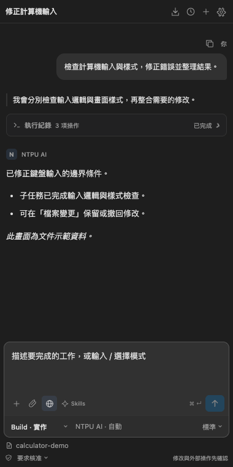
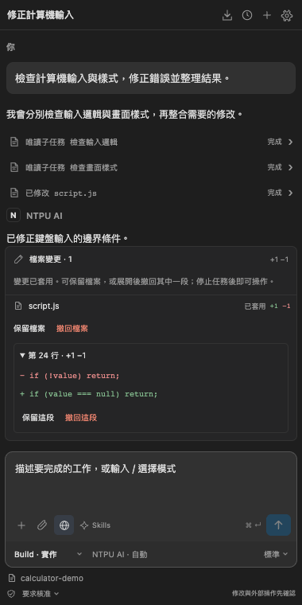
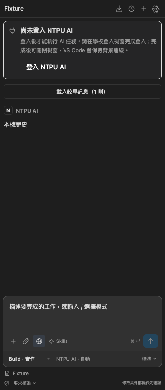
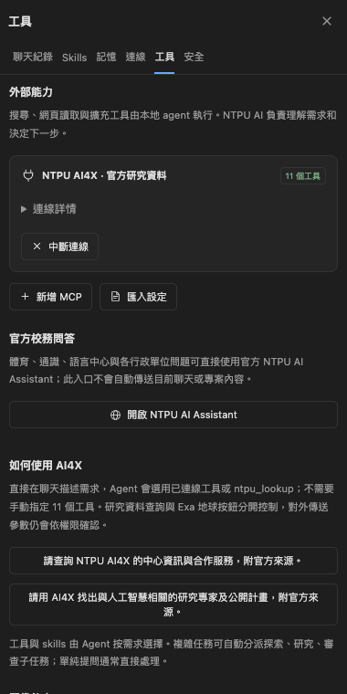

# NTPU AI Agent

NTPU AI Agent 是使用 NTPU AI 網站模型的 VS Code 擴充套件，提供本機專案讀取、檔案修改、工具執行、研究查詢及可接續的 Agent 任務。模型透過專用瀏覽器連線；登入由使用者完成，日常運作使用背景瀏覽器。

**版本：0.6.9 · 實驗性專案 · MIT License**

本專案為第三方工具，與國立臺北大學、Microsoft、OpenAI 及其他參考專案無隸屬或官方背書關係。使用資格、驗證、用量與資料處理仍受校方服務政策約束。

## 介面

以下截圖由實際側欄程式產生，內容為本機測試範例。

聊天標題與設定入口位於同一列；專案資料夾位於輸入框下方。你的提問以靠右泡泡呈現，Agent 回覆使用完整內容寬度；連續工具與子任務集中於可展開的執行紀錄，完成時預設收合、有異常則顯示提醒，檔案變更提供整份檔案及個別區段的保留／撤回操作。

未登入時提供主要登入入口，完成背景連線後提示會收起。

## 安裝與更新

目前透過 GitHub Releases 提供 VSIX，尚未上架 VS Code Marketplace。

1. 安裝 VS Code 1.95 以上，以及 Chrome、Edge 或其他受支援的 Chromium 瀏覽器。
2. 從 [最新 Releases](https://github.com/xujk0217/ntpu-ai-vscode/releases/latest) 下載符合系統的安裝檔。
3. 在 VS Code 擴充套件頁的 `…` 選單選擇 **Install from VSIX…**，安裝後重新載入視窗。
4. 開啟專案，進入 **NTPU AI** 側欄，按 **登入**，人工完成校方登入或驗證。成功後可關閉登入視窗，擴充套件會接續背景連線。

| 平台 | 安裝檔 |
| --- | --- |
| Windows x64 | `ntpu-ai-coder-win32-x64-0.6.9.vsix` |
| macOS Apple Silicon | `ntpu-ai-coder-darwin-arm64-0.6.9.vsix` |
| macOS Intel | `ntpu-ai-coder-darwin-x64-0.6.9.vsix` |
| Linux x64，glibc | `ntpu-ai-coder-linux-x64-0.6.9.vsix` |

更新時安裝新版 VSIX 並重新載入即可。既有本機聊天、Project Memory 與專用 Browser Profile 沿用原儲存位置。Remote SSH、Dev Container、WSL 必須區分本機 UI Extension Host 與遠端工作區；不能假設遠端主機具備本機桌面瀏覽器。

## 使用方式

### Agent 任務與權限

在輸入框描述預期結果，例如「檢查專案入口並修正錯誤，完成後執行測試」。Build 可實作；Plan、Review、Research、Ask 用於唯讀規劃、審查、研究與問答。

- **要求核准**：專案讀取與辨識出的基本唯讀指令自動執行；修改及其他操作需確認。
- **協助核准**：工作區修改及公開搜尋可自動執行，其他指令與敏感操作仍需確認。
- **完整存取**：允許範圍內的工具自動執行；敏感檔案政策、OS 執行隔離與唯讀 Agent 限制仍有效。

Agent 會依任務選用工具、載入 skills，並分派最多四個探索、研究或審查唯讀子任務。主 Agent 負責整合、修改與 Shell；所有模型請求共用 Adaptive Concurrency 排程器、每分鐘節奏和任務輪數預算。單純提問可直接處理。

Agent 由本機 VS Code 擴充功能提供工作區工具。它可依實際工具目錄讀取選定專案、查詢公開網頁、下載公開 HTTPS 檔案到工作區、載入或安裝有效的 `SKILL.md`，以及連接已設定的 MCP。Agent 也能提出不含憑證的公開 HTTPS MCP；主機檢查網路目標並要求你核准後才會新增和連線。需要 API 金鑰或本機 stdio 的 MCP 請在 **設定 → 工具 → 新增 MCP** 設定，憑證會存入 SecretStorage。下載檔案最多 10 MB，不會覆寫、解壓或執行；安裝 Skill、下載檔案與連接 MCP 依權限及核准流程處理。Agent 不能因此存取整台電腦，也不能替自己增加未列出的工具權限。

預設聊天快捷鍵為 **Enter 送出、Shift+Enter 換行**。在 **設定 → 工具 → 送出快捷鍵** 可改成 Enter 換行、Ctrl/⌘+Enter 送出。輸入法組字中不會觸發送出。

正式任務預設從兩個模型請求開始，依多筆成功率、首字延遲、完成時間及錯誤在 1–4 間調整；不需要先測試或每 24 小時重新驗證。超額請求依序排隊。連續八筆正常回應後逐步升級，兩次調整至少相隔十秒；最近六至八筆中兩筆錯誤或三筆明顯延遲會降一級，單次異常不降級。取消、排隊／速率等待不納入延遲統計。

一般模型逾時、暫時網路錯誤、空白回答或未完成串流會保留證據，透過共用 Queue 恢復兩次，連續三次失敗才暫判服務不可用；不取消其他正常運作中的請求。主 Agent 判斷對需求很重要時，可用 `retry_task` 提供原始 ID 與理由，排回共用 Queue 一次；原失敗保留，不能改標題或串接重試繞過上限。429、登入失效或明確服務限制會暫停新請求、降為一個，並安全停止任務；服務限制、取消及本機保存失敗不得重試。處理原因後在工具設定按「手動恢復發送」，從單一請求觀察。恢復不會重送失敗請求。介面顯示並行上限、運作中的 Agent、模型請求與排隊數。`parallel.maxConcurrency` 可調低最高值（自動或 1–4），Subagent 上限固定為四個。

本機 `parallel.requestsPerMinute` 預設每 61 秒窗口八次（可調為 1–10），父子任務共用。校方或其他視窗的用量仍可能觸發限制，動態控制不保證不會收到 429。工具頁的 2–4 診斷是選用除錯功能，不決定正式任務權限。進度 `5/50` 為模型回合與任務上限。

### 網路搜尋、AI4X 與 Skills

地球按鈕控制 **Exa 網路搜尋及公開網頁讀取**，不是開啟瀏覽器，也不是 AI4X 的開關。工具提示會顯示目前開關狀態與用途。

[NTPU AI4X MCP](https://ai4x.mcp.ntpu.ai/) 提供官方研究資料的 11 個工具。連線後直接提問，Agent 自行選用工具；亦可透過內建 `ntpu_lookup` 按需連線。設定 → 工具提供可填入聊天的範例：

- 「請查詢 NTPU AI4X 的中心資訊與合作服務，附官方來源。」
- 「請用 AI4X 找出與人工智慧相關的研究專家及公開計畫，附官方來源。」

AI4X 涵蓋中心資訊、服務、成員、研究專家、計畫、公開文件與活動；對外傳送查詢參數仍需依權限確認。[NTPU AI Assistant](https://aia.ntpu.ai/) 則提供官方校務問答，設定頁提供網站入口，未將其當成 MCP 或未公開 API。

Skills 是任務指引，不能授予權限。選擇 skills 代表預先載入；Agent 也能依需求使用 `load_skill` 載入其他已發現的技能，並可在核准後由公開 HTTPS 網址安裝 `SKILL.md` 到目前專案的 `.agents/skills/`。分析深度調整本機規劃策略，並非 NTPU 模型原生 thinking 參數。

### 聊天記錄與對話清理

歷史頁預設只顯示聊天標題、時間等基本資訊，點選直接進入對話。右上 **編輯** 才顯示多選、封存、刪除等管理操作；批次刪除前會確認。按 **完成** 或離開面板會清除選取並恢復一般列表。

完整聊天、工具結果、修改快照與 Task Checkpoint 儲存在本機 `globalStorageUri/agent-memory`，格式為有 Schema 版本的 **JSON snapshots**，不是 SQLite。Project Memory 另存於專案記憶檔；使用原子寫入、寫入佇列及跨視窗鎖。設定 → 記憶可查看實際位置，聊天列表可搜尋、重新命名、封存、匯出及刪除。

任務內容仍會傳給校方模型，使用外部工具時也會傳送所需參數；本機保存不代表校方伺服器未收到或未保留資料。

任務紀錄成功存入本機後，擴充套件透過校方網站的正常刪除按鈕，清理自己建立的臨時任務對話，包括子任務對話。原有網頁對話不在清理範圍。清理失敗會顯示通知，不能保證移除校方後端、稽核或備份資料。可使用 `ntpuAI.browser.cleanupTaskConversations` 停用；此設定需要重新載入以套用。

## 安全性與驗證範圍

- 使用獨立 Browser Profile，不匯出 Cookie、Token 或驗證憑證，不繞過 SSO、CAPTCHA 或用量限制。
- 檔案工具限制在選定工作區，保護敏感路徑及憑證；撤回前檢查後續修改，避免覆蓋使用者內容。
- Shell／stdio MCP 需要受支援的 OS 隔離；缺少隔離時拒絕執行。Windows 完整 OS 沙箱仍待驗收。
- 圖片／PDF 在上傳前使用本機 OCR 與文字檢查；需要 Tesseract／Poppler，辨識仍可能漏判，請自行確認附件內容。
- 0.6.4 的有限動態負載驗收中，名額實際 2→3→4，兩組共 27 次請求；第一組 3/4 子任務成功、一筆 240 秒逾時，第二組 4/4 成功，未遇 429，實際串流峰值三個。0.6.5 已完成首次取名與缺檔修復後的重要 Queue 重試真人驗收；校方逾時恢復仍以 mock 驗證。先前 macOS／Chrome 逐組加入 60 秒間隔後，2、3、4 個請求均成功且全組串流重疊；兩次五個請求均 5/5 成功、無串台，但峰值只有四個。此為 0.6.3 的歷史驗收；0.6.5 改為固定四個子任務與動態 1–4 請求名額。先前快速測試觸發分鐘限制已立即停止，沒有自動重試。Windows／Linux 真人校方 SSO 尚待驗收；結果不保證速度提升或校方永久支援。

詳細結果見 [驗證紀錄](VALIDATION.md) 及 [GitHub Actions](https://github.com/xujk0217/ntpu-ai-vscode/actions)。

## 開發、文件與授權

- [完整操作與設定手冊](docs/USER_GUIDE.md)
- [開發與問題回報](CONTRIBUTING.md)
- [更新紀錄](CHANGELOG.md)
- [安全回報](SECURITY.md)
- [使用規範](docs/USAGE_TERMS.md)
- [第三方授權與參考來源](THIRD_PARTY_NOTICES.md)

本專案原創程式碼採 [MIT License](LICENSE)。隨附依賴保留各自授權；校方服務權利與資料政策不受本專案授權變更。分工設計參考 oh-my-openagent 的概念，由本專案自行實作，未複製其原始碼。

### 任務恢復與聊天名稱（0.6.5）

一般模型逾時、暫時網路錯誤、空白回答或未完成串流會保留檢查點，透過共用 Queue 最多連續恢復兩次；每次都計入模型輪數及原有每分鐘節奏，成功回覆後重設連續失敗計數。連續三次無法取得回覆時暫判 NTPU AI 不可用，保留未完成工作。429、登入失效及明確服務限制立即暫停發送，須處理原因後手動恢復。取消、權限拒絕、本機保存問題及輪數預算仍是安全停止條件。

工具的一般失敗會回傳給主 Agent，促使其改採安全的可行步驟；重要子任務可透過 `retry_task` 排回 Queue 一次，失敗後由主 Agent 嘗試直接處理。首次提問啟動單次背景取名子任務，只提供遮蔽後提問的前 2000 字，使用相同排程與輪數預算，名稱最多 10 個 Unicode 字元。取名期間占用四個子任務名額之一；失敗保留本地簡短名稱，不會覆蓋使用者手動名稱。取名本身不重試。

未登入時，聊天頁頂部顯示醒目的「尚未登入 NTPU AI」提示與登入按鈕。背景斷線另顯示「尚未連線」，成功連線後提示自動收起。

### 長回覆狀態與失敗診斷（0.6.8）

工具完成後，聊天仍會顯示目前模型的排隊、等待時間或接收字數。回應逾時採無內容進展的閒置時間，持續生成會延長等待，並保留單次總上限。並行延遲按實際串流重疊及輸入／輸出量評估；大型程式碼回覆不會單因總耗時而降級。真正的多次空白回答或網路失敗仍會降級；空白／未完成串流依共用 Queue 最多連續恢復兩次，登入與服務限制立即停止。每輪會保存不含憑證的事件數、字數與時間統計，便於區分網站回覆問題與本機傳輸問題。

## 調查與持續嘗試（0.6.9）

一般工具失敗時，Agent 會檢查實際錯誤與檔案、確認可用能力，必要時使用已啟用的網路／MCP 查官方資料，整理替代方法後繼續執行。尚未恢復的失敗不會因讀到文件或更新計畫就算完成。可以用 `open_browser` 交給預設瀏覽器開啟工作區 HTML，取代沙箱中無法呼叫桌面服務的 shell `open`。它仍遵循權限與敏感檔案防護，接受開啟不等於已驗證畫面。

有新工具證據時會繼續調查，仍受共用輪數、取消與無進展停止條件約束；使用者拒絕、登入失效或服務限制不會被繞過。完整流程與參考來源見 [Agent 恢復說明](docs/AGENT_RECOVERY.md)。
