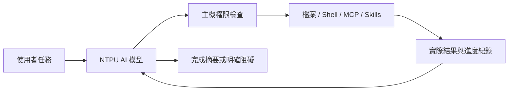

# NTPU AI Agent for VS Code

以 NTPU AI 網頁模型驅動的本地 VS Code 程式開發 Agent。

本專案將模型推理與本地操作分開：NTPU AI 理解需求並提出下一個動作；擴充功能執行權限檢查、檔案操作、終端機與 MCP，將真實結果交回模型，持續處理到完成或遇到明確阻礙。

**版本：0.4.0 · 狀態：實驗版 · Local-first Memory／敏感資料防護／多平台 Browser Manager**

本專案為非官方整合，與 NTPU AI、Microsoft、GitHub、OpenAI 或 Exa 無官方隸屬或背書關係。

## 目錄

- [功能](#功能)
- [安裝與登入](#安裝與登入)
- [完整任務流程](#完整任務流程)
- [Agent 模式](#agent-模式)
- [工具紀錄與介面](#工具紀錄與介面)
- [本機記憶與隱私](#本機記憶與隱私)
- [瀏覽器與平台](#瀏覽器與平台)
- [權限與終端機規則](#權限與終端機規則)
- [Skills](#skills)
- [MCP 與網路搜尋](#mcp-與網路搜尋)
- [圖片與分析深度](#圖片與分析深度)
- [資料處理與限制](#資料處理與限制)
- [開發與測試](#開發與測試)
- [授權與使用規範](#授權與使用規範)

## 功能

- 多輪 Agent 工具迴圈：讀取、規劃、建立／精確修改檔案、執行指令、檢查結果並繼續。
- Build、Plan、Review、Research、Ask 五種模式，唯讀限制由主機強制執行。
- 三種權限模式、自訂指令開頭／正規表示式規則、單次及工作階段核准。
- 精簡的灰色執行紀錄，點開查看實際結果、指令輸出、退出碼與耗時。
- 工作階段、近期對話、任務清單、提問佇列、diff、回復與 Markdown 匯出。
- SKILL.md 技能探索及載入，支援多種常用技能目錄。
- 真正 MCP client，支援 stdio、Streamable HTTP、SSE 與設定匯入。
- Exa MCP 搜尋、公開網頁讀取、真實圖片分析與 SVG → PNG 繪圖。

## 安裝與登入

### 系統需求

- VS Code 1.95 以上。
- 已安裝 Google Chrome、Microsoft Edge 或 Chromium。自訂模式需 Chromium 系執行檔。
- NTPU AI 允許使用的帳號或訪客資格。
- 目標平台：Windows x64、macOS arm64／x64、Linux x64（Ubuntu／Debian）。Linux 互動登入需要桌面顯示環境。實際驗證範圍見下方平台表與驗收文件。

### 安裝

從 [Releases](https://github.com/xujk0217/ntpu-ai-vscode/releases) 選擇已發布版本的對應 VSIX；最新開發套件可在 [Actions](https://github.com/xujk0217/ntpu-ai-vscode/actions) 的成功 CI 中下載平台 artifact。目前尚未上架 Marketplace。

| 系統 | VSIX target |
| --- | --- |
| Windows x64 | win32-x64 |
| macOS Apple Silicon | darwin-arm64 |
| macOS Intel | darwin-x64 |
| Linux x64（glibc） | linux-x64 |

下載後在 VS Code 執行 **Extensions: Install from VSIX** 並選擇檔案。也可執行 `code --install-extension <下載的檔案.vsix> --force`。更新同樣安裝新版套件。

已開啟的視窗請執行 **Developer: Reload Window**。

### 登入

1. 開啟專案資料夾，點 Activity Bar 的 **NTPU AI**，或執行 **NTPU AI: 開啟程式助理**。
2. 點 **連線 NTPU AI**，在擴充功能開啟的專用瀏覽器內完成學校 SSO 與機器人辨識。
3. 回到側欄，連線狀態應顯示 **已連線**。
4. 以 Build 模式輸入任務，按送出或 `Cmd+Enter`／`Ctrl+Enter`。

登入保留在獨立 browser profile。VS Code 預設路徑為 `globalStorageUri/browser-profiles/<browser>`，不同瀏覽器與不同 Custom 執行檔互相隔離。這不是 VS Code 帳號登入；工作階段過期時，在專用瀏覽器重新登入並完成機器人辨識。0.3.x 舊 Chrome profile 仍保留在原路徑，不複製 Cookie；升級後的新隔離位置需要重新登入一次。

未登入時，主介面會顯示 **連線 NTPU AI**。登入後，主介面會收起連線狀態；到右上角 **設定 → 工具／設定** 查看帳號狀態或登出。登出前會再次確認，並清除專用瀏覽器內 NTPU／北大網域的 Cookie 與 NTPU AI 網站儲存資料；其他網站的瀏覽器資料不會清除。也可從命令面板執行 **NTPU AI: 登出並清除本機登入資料**。

每個 VS Code 使用者任務會建立一個 NTPU AI 網頁對話；同一任務的 agent 後續輪次會沿用該對話，下一個 VS Code 任務才建立新的 NTPU AI 對話。

專用瀏覽器需保持開啟；同一個 profile 不可同時供兩個擴充功能視窗使用。切換帳號或瀏覽器只變更推論通道，本機歷史與檢查點仍保留。

## 完整任務流程

例如：

> 查看目前專案，新增 mean(values)，空陣列回傳 null。建立 Node 測試，驗證平均值、負數與空陣列，執行測試；有錯誤就修正到通過。

Agent 每一輪會收到最初需求、專案脈絡與實際工具紀錄，再選擇下一個工具。你不需要手動把每個結果重新貼回模型。需要核准時，流程會等待核准；核准後自動繼續。



Build 會修復一般文字回覆造成的工具格式偏差；未完成的計畫會要求模型繼續，不能只把計畫當成實作完成。工具連續重複且沒有新結果、登入失效、需要資訊、拒絕核准或達到步數上限時會停止。

未完成任務保留最近工具檢查點。輸入「繼續」或 `continue` 可帶入原任務與先前結果；修改檔案仍需重新確認當前內容。停止不會自動回復已套用的修改。

## Agent 模式

| 模式 | 目的 | 本地操作 |
| --- | --- | --- |
| Build · 實作 | 完成需求、修改並驗證 | 依權限允許全部現有工具 |
| Plan · 規劃 | 檢視專案並提出可執行計畫 | 唯讀；不實作計畫 |
| Review · 審查 | 找出具體錯誤、觸發條件與檔案位置 | 唯讀 |
| Research · 研究 | 搜尋來源、讀取資料並附連結 | 唯讀與公開網路工具 |
| Ask · 問答 | 解釋程式、回答問題 | 唯讀 |

提問框支援 `/build`、`/plan`、`/review`、`/research`、`/ask`。唯讀模式禁止寫入、一般可修改資料的 shell 指令及未標示唯讀的外部 MCP；此限制優先於完整存取、指令允許規則及工作階段授權。

## 工具紀錄與介面

- 模型可在重要階段用一兩句說明下一步或發現，不顯示內部推理內容。
- 灰色工具列顯示「已讀取／已建立／已修改／已執行」與檔名／指令；點右側箭頭展開詳情。
- 終端機輸出在執行時更新，完成後提供輸出、退出碼、核准來源與耗時。
- 檔案變更可開啟 diff 或回復；後續有新修改時會拒絕覆蓋。回復新檔使用系統垃圾桶。
- 提問可附目前檔案／選取內容、額外專案檔、圖片或 PDF。
- 忙碌時可排入下一個提問，最多五項；停止會取消目前工作與佇列。
- 完整本機歷史不再以 25 個 Session／100 則訊息截斷；一次顯示 50 則，支援載入較早訊息、搜尋、封存、刪除、重新命名與完整匯出。

這是自行實作的 VS Code webview，參考 Codex／Copilot 的互動方式，並非直接搬入它們的產品 runtime。

## 本機記憶與隱私

右上齒輪 → **記憶** 可管理三層資料：

- **Project Memory**：跨 Session 共用的架構、決策、偏好、待辦與實際工具證據。每筆可查看 Task ID、路徑、確認時間與 stale 標記，並手動新增、編輯或刪除。
- **Session Memory**：完整對話、工具結果、計畫、修改快照、任務列表及摘要，可離線瀏覽與切換。
- **Task Memory**：每次使用者提問的需求、狀態、開始／結束時間、工具實際結果、修改路徑、驗證及檢查點。未完成任務可從記憶頁點 **接續任務**；恢復時重新讀取檔案，舊證據不作為目前檔案的保證。

資料位於 VS Code 的私有 `globalStorageUri/agent-memory`，使用有 Schema 版本的 JSON snapshots、fsync／原子 rename、寫入佇列與跨視窗鎖。並行寫入不同版本時，保留衝突副本並報錯，避免默默覆蓋。沒有新增資料庫或向量服務依賴。

舊版 `workspaceState` 先建立遮蔽後備份，再保留 Session ID 遷移；成功後移除舊欄位。無法轉換的資料仍留在遷移備份，並顯示錯誤。此流程無法恢復舊版本已截掉的歷史。資料夾包含 `sessions/`、`projects/`、`backups/`、`conflicts/`；完整匯出預設在私人儲存區，備份還原以新 Session ID 匯入，不覆蓋現有紀錄。

**完整保存不等於完整傳送。** Context Manager 依關鍵字、中文片語、檔案與未完成狀態挑選相關 Project Memory、Session 摘要、先前 Task 和最近對話；字元預算優先保留當前需求、主機規則與工具結果。資料僅從本機恢復，不需讀取舊帳號的 NTPU AI 網頁聊天。自動摘要根據實際工具結果建立，不在背景另呼叫模型；可停用 Project Memory／自動更新，也可手動重新整理。

主機端敏感資料政策：

| 分類 | 行為 |
| --- | --- |
| Protected | `.env`、私鑰、`.npmrc`、`.pypirc`、雲端／SSH／Kube 憑證與受保護資料目錄禁止 Agent 檔案存取，完整存取也不能繞過 |
| Review Required | CSV、部分私人設定及 `privacy.reviewPaths` 自訂 glob，納入脈絡／工具讀取前需要單次確認 |
| Normal | 一般程式碼依原權限使用；內容仍通過秘密偵測與遮蔽 |

`.env.example`／sample／template 允許讀取，但真實格式的秘密仍會遮蔽。共用 guard 覆蓋 Editor、檔案、搜尋、Terminal、MCP、模型請求、歷史、Project／Task、Checkpoint、diff 與匯出。辨識已知 API key、私鑰、Bearer、JWT、密碼／secret 欄位、資料庫字串、URL 帳密和敏感 query，保留其他程式結構。外部查詢含已知秘密會拒絕，文字結果在送模型及寫入磁碟前遮蔽。

含秘密的既有檔案會拒絕 Agent 改寫；含遮蔽值的舊快照也不允許直接回復，避免把 `[REDACTED]` 覆蓋到憑證。圖片與 PDF 無法用文字 guard 辨識其中的秘密，上傳必須再次確認目的地與內容。使用者附件預覽不保存為 Session 的永久圖片；輸出圖片快取仍是私人本機資料。

## 瀏覽器與平台

齒輪 → **工具／設定** 提供 Browser、Custom Browser Path、Browser Profile Location、連線結果及重新連線。Auto 先嘗試受支援的系統預設瀏覽器；預設為 Safari／Firefox 或不可用時，選擇已安裝的 Chrome、Edge、Chromium。只有 Playwright 成功啟動並能操作 Chromium 頁面，才顯示可控制。明確失敗時會顯示原因與替代選項，不會僅開 URL 就宣稱成功。

可手動選擇 Chrome／Edge／Chromium，或設定 Custom 的執行檔絕對路徑。程式不自動下載日常瀏覽器。Chromium 也可由開發者執行 `npx playwright-core install chromium` 安裝後偵測；登入驗證仍由使用者完成。所有啟動保留 Chromium sandbox，不使用 remote debugging attach 或一般瀏覽器 Profile。

Extension 使用 VS Code 本機私有儲存；獨立 BrowserManager 的預設資料根目錄則依平台選擇：

| 系統 | 資料目錄與驗證狀態 |
| --- | --- |
| Windows x64 | `%LOCALAPPDATA%/NTPU AI Agent`；Edge 偵測／控制已通過 mock，實機驗證以 CI 紀錄為準 |
| macOS arm64 | `~/Library/Application Support/NTPU AI Agent`；真實 Chrome headed／headless 的 localhost 整合測試通過 |
| macOS x64 | 同 macOS 路徑；獨立 CI 目標，尚未在使用者 Intel 裝置驗證 |
| Linux x64 | `$XDG_DATA_HOME/ntpu-ai-agent` 或 `~/.local/share/ntpu-ai-agent`；Chromium mock 通過，實機驗證以 CI 紀錄為準 |

Unix 目錄／檔案用 0700／0600；Windows 依私有應用資料目錄的使用者 ACL。拒絕 Profile 指向日常 Chrome／Edge／Chromium 資料、家目錄、專案或其 symlink 別名。瀏覽器原生 profile lock 衝突會明確報錯；不刪除瀏覽器的鎖來強制取得日常 profile。

Extension 優先在本機 UI Host 執行。Remote SSH／Dev Container／WSL 不等同使用者桌面：本機歷史可讀，但此版本不支援對遠端工作區執行檔案／終端機任務；遠端 Host／WSL 不會假裝已連上本機圖形瀏覽器。Linux 無 DISPLAY／WAYLAND 顯示環境也會清楚報錯。其他 ARM64 平台、Alpine／musl 與 Attach Existing Browser 尚未支援。

## 權限與終端機規則

### 權限模式

| 模式 | 預設行為 |
| --- | --- |
| 要求核准 | 自動讀取專案、使用 skills 與基本唯讀指令；修改、未允許指令、網路及外部工具先核准 |
| 協助核准 | 自動修改工作區、公開搜尋／讀取網頁、圖片分析及符合規則的指令；其他操作核准 |
| 完整存取 | 自動執行目前 Agent 允許的內建工具；敏感資料／附件、自訂 MCP 個別核准與明確指令規則仍適用 |

核准卡支援單次核准，或在此工作階段允許同一工具。資料確認與自訂 MCP 僅授權單次呼叫。重新載入擴充功能恢復「要求核准」。完整存取切換時會說明範圍並確認。

檔案工具限制於選定工作區，檢查符號連結、秘密檔案及修改衝突。Shell 與 stdio MCP 以你的 OS 帳號權限執行，**沒有 OS 隔離沙箱**。

### 自動核准指令

工具設定面板的 **設定指令自動核准**可開啟 VS Code 使用者設定。這些設定只在 application／user 層級生效，不能由專案設定授權。

內建的基本指令包含：`pwd`、`whoami`、`ls` 與少數列目錄 flags、`node --version`、`npm --version`、`python3 --version`、`git --version`、有限的 `git status` 與安全 diff 格式。Windows 另外支援 `cd`、`ver`、有限 `dir`、`python --version`／`py --version`，主機會告知模型目前使用 cmd.exe。

自訂範例：

```json
{
  "ntpuAI.terminal.enableAutoApprove": true,
  "ntpuAI.terminal.autoApprove": {
    "npm run build": true,
    "npm test": true,
    "/^node --test(?: |$)/": true,
    "rm": false,
    "git push": false
  }
}
```

- `true`：允許以此指令開頭的完整 token 邊界；`npm run build` 不會匹配 `npm run build-evil`。
- `false`：必須核准，優先於允許規則、工作階段授權及完整存取。它不是永久禁止執行。
- `null`：忽略此條規則。
- 正規表示式須包在 `/.../` 或 `/.../i` 中、以 `^` 開頭；格式錯誤不允許自動核准。
- 非完整存取模式下，重新導向、管線、複合指令、環境變數指定與 shell 展開需要核准，即使前綴符合。
- `enableAutoApprove: false` 會要求核准每個 shell 指令，完整存取也不例外。

這是保守的規則比對，不是完整 shell 語法分析或安全性證明。允許 `npm run build` 也允許執行該專案 build 腳本。每個指令目前最多執行 60 秒。

## Skills

內建四個技能：`code-review`、`debug`、`web-research`、`visual-design`。可從 Skills 面板選取，或由 Agent 按需載入。

自動掃描 `<名稱>/SKILL.md`：

```text
專案/.agents/skills/
專案/.opencode/skills/
專案/.claude/skills/
~/.ntpu-ai-coder/skills/
```

也可從 **加入使用者 skills 資料夾**加入其他根目錄。

```md
---
name: my-workflow
description: 說明這個技能的適用工作
---
先查看專案慣例，依現有工具完成工作，最後回報實際結果。
```

目前支援 frontmatter 的 name／description 與本文指導。Skills 不會變更權限、自動安裝套件或執行附帶腳本。引用的其他檔案需要現有工具與允許的路徑配合讀取。

## MCP 與網路搜尋

NTPU 模型本身不必具備搜尋工具。地球按鈕啟用本地 `web_search`，透過 [Exa MCP](https://exa.ai/docs/get-started/exa-mcp) 取得真實來源；免金鑰用量有限，失敗會顯示錯誤。`web_fetch` 讀取公開網頁，會拒絕本機及私人網路位址。

在 **工具 / MCP** 面板可：

1. 查看伺服器、連線結果、工具清單與錯誤。
2. 新增遠端 Streamable HTTP 或本地 stdio 伺服器。
3. 匯入 VS Code `servers`、Claude `mcpServers`、OpenCode `mcp` JSON／JSONC 設定；也支援 SSE。
4. 連線前確認 endpoint 或本地執行指令。匯入不會自動啟動。

金鑰與 header／環境變數值存入 VS Code SecretStorage。動態環境變數、OAuth 或供應商特定設定可能需要另外配置。目前自訂 MCP 在唯讀 Agent 中採保守限制，可在 Build 中依權限使用；並非完整移植其他產品的 MCP runtime。

## 圖片與分析深度

- 圖片／PDF 附件透過 NTPU 正常上傳介面送出，模型能力依網站路由決定。
- `inspect_image` 實際讀取專案圖片並交由 NTPU 分析；支援 PNG、JPEG、WebP、GIF，最大 8 MB。
- `create_visual` 由模型編寫 SVG，在本地轉成 PNG，適合圖解、圖示與簡單插畫。
- 照片風格或專用影像生成需要自行接上影像 MCP；可顯示、開啟及另存 MCP 回傳的圖片資料。

快速／標準／深入控制分析策略與最多輪數（12／50／100），同時受 `maxSteps` 限制，預設 50。**NTPU 網頁目前未提供原生 thinking／reasoning_effort 設定或任意模型切換。** 深度不是模型的原生推理參數；模型依網站自動路由，側欄顯示回報的名稱。

## 資料處理與限制

提問、專案片段、附件與工具結果會交給 NTPU AI；查詢會送往 Exa，自訂工具輸入送往設定的 MCP。登入 Cookie 留在專用瀏覽器，不擷取學校密碼或匯出 Cookie。

工作階段、Project／Task Memory、遮蔽後快照及圖片快取保存在本機 VS Code 私有資料區；各瀏覽器 profile 保存在獨立目錄。`.local`、登入資料、node_modules 與 VSIX 不會提交到本儲存庫。

每個使用者任務建立一個暫時 NTPU AI 對話，同一任務多輪沿用；後續任務由本機脈絡接續，不依賴前次網站對話。未自行呼叫遠端刪除 API，也不聲稱刪除本機資料能清除校方留存。

限制包括：網站改版、登入過期、限流、模型未遵守 JSON 協定、指令 60 秒限制及工具輪數限制。失敗或逾時不自動重送網站請求。超大 JSON Session 的 snapshot 寫入成本、學校 SSO／驗證網站變動、全部 PDF 模型路由及第三方 MCP 行為未全面驗證。文字秘密偵測是已知格式／上下文規則，無法保證辨識任意私人資訊或圖片憑證。Shell／stdio MCP 具有使用者 OS 權限，可自行讀取檔案或連網；Host guard 不能取代完整 OS sandbox。

## 開發與測試

Node.js 20.9 以上：

```sh
npm ci
npm run build
npm test
npm run package
```

在 VS Code 開啟本專案，按 F5 啟動 Extension Development Host。

- `npm test`：主機 Agent、權限、檔案、SSE、MCP、skills 與影像測試。
- `npm run smoke`：真實 NTPU 網頁連線；需要正常登入，會使用網站用量。
- `npm run mcp:smoke`：真實 Exa MCP 搜尋。
- `npm run browser:fixture`：localhost mock 網站＋真實瀏覽器／Webview，不需 NTPU 帳號，不耗學校用量。
- GitHub Actions：Windows x64、macOS arm64／x64、Linux x64，Node 20／22，unit、build、localhost 瀏覽器整合與平台 VSIX artifact。
- `npm run package -- --target <target>`：原生 sharp 經實際 PNG 驗證後打包；要求 host 與 target 相同。在對應平台 CI 安裝其 optional dependencies，拒絕將 macOS 套件直接改標成 Windows／Linux。

0.4.0 架構、遷移、測試與交付狀態：[docs/REFACTOR_REPORT.md](docs/REFACTOR_REPORT.md)。歷史驗證結果：[VALIDATION.md](VALIDATION.md)。開發說明：[CONTRIBUTING.md](CONTRIBUTING.md)。

### 主要設定

| 設定（前綴 ntpuAI） | 預設 | 用途 |
| --- | --- | --- |
| browser | auto | auto／chrome／edge／chromium／custom |
| customBrowserPath | 空白 | 自訂 Chromium 執行檔 |
| chromePath | 空白 | 舊版相容設定，請改用 customBrowserPath |
| browserProfilePath | 私有儲存區 | 各瀏覽器 profile 的獨立根目錄 |
| memory.enableProject | true | 帶入 Project Memory |
| memory.autoUpdate | true | 根據工具結果整理記憶 |
| privacy.reviewPaths | [] | 傳送前確認的額外路徑 glob |
| maxSteps | 50 | 每次任務工具輪數，上限 100 |
| responseTimeoutSeconds | 240 | 每次模型回答等待時間 |
| contextCharacters | 64000 | 本地模型脈絡字元預算 |
| skillDirectories | [] | 額外技能根目錄 |
| terminal.enableAutoApprove | true | 啟用指令規則 |
| terminal.autoApprove | {} | 使用者指令規則 |

## 授權與使用規範

原創程式碼採 [MIT License](LICENSE)。第三方套件保留各自授權，詳見 [THIRD_PARTY_NOTICES.md](THIRD_PARTY_NOTICES.md)。

使用 NTPU AI、Exa 與其他 MCP 仍須遵守各服務的資格、用量及條款；本專案不授予第三方帳號或服務存取權。軟體按現狀提供，不保證模型正確性、服務持續可用或任務必定完成。

完整說明：[授權與使用規範](docs/USAGE_TERMS.md)。安全回報：[SECURITY.md](SECURITY.md)。

## 參考

- [codex-chatgpt-web](https://github.com/miuuyy/codex-chatgpt-web)：瀏覽器橋接與本地工具迴圈概念。
- [VS Code 原始碼](https://github.com/microsoft/vscode)、[Copilot Chat 原始碼](https://github.com/microsoft/vscode-copilot-chat)：工具時間軸與指令核准互動。
- [OpenCode permissions](https://opencode.ai/docs/permissions/)、[skills](https://opencode.ai/docs/skills/)：模式、權限與技能目錄。
- [NTPU AI](https://ai.ntpu.edu.tw/)：實際模型服務。
