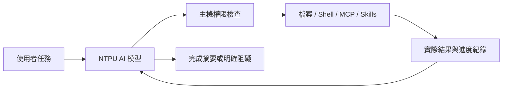

# NTPU AI Agent for VS Code

以 NTPU AI 網頁模型驅動的本地 VS Code 程式開發 Agent。

本專案將模型推理與本地操作分開：NTPU AI 理解需求並提出下一個動作；擴充功能執行權限檢查、檔案操作、終端機與 MCP，將真實結果交回模型，持續處理到完成或遇到明確阻礙。

**版本：0.6.9 · 狀態：實驗版 · Local-first Memory／敏感資料防護／多平台 Browser Manager**

## Agent 能力與送出快捷鍵

Agent 由本機 VS Code 擴充功能操作目前選取且已信任的工作區。它會使用目前實際啟用的工具，不代表可任意讀取整台電腦。公開網路搜尋與網頁讀取由地球按鈕控制；下載公開 HTTPS 檔案、安裝 Skill 與連接 MCP 會依權限顯示核准，檔案只存入工作區、不會自動執行。Agent 可安裝已驗證格式的 `SKILL.md` 到 `.agents/skills/`，可連接已設定的 MCP，也能提出不含憑證的公開 HTTPS MCP，經主機檢查及你的核准後新增。需要 API 金鑰或本機 stdio 的 MCP，請從「設定 → 工具 → 新增 MCP」完成登記並保存憑證。

聊天預設按 **Enter 送出**、按 **Shift+Enter 換行**。在「設定 → 工具 → 送出快捷鍵」可改為 **Enter 換行**、**Ctrl/⌘+Enter 送出**。輸入法組字和長按 Enter 不會觸發送出。

本專案為非官方整合，與 NTPU AI、Microsoft、GitHub、OpenAI 或 Exa 無官方隸屬或背書關係。

## 目錄

- [功能](#功能)
- [安裝與登入](#安裝與登入)
- [完整任務流程](#完整任務流程)
- [Agent 模式](#agent-模式)
- [工具紀錄與介面](#工具紀錄與介面)
- [本機記憶與隱私](#本機記憶與隱私)
- [瀏覽器與平台](#瀏覽器與平台)
- [權限與終端機規則](#權限與終端機規則)
- [Skills](#skills)
- [MCP 與網路搜尋](#mcp-與網路搜尋)
- [圖片與分析深度](#圖片與分析深度)
- [資料處理與限制](#資料處理與限制)
- [開發與測試](#開發與測試)
- [授權與使用規範](#授權與使用規範)

## 功能

- 多輪 Agent 工具迴圈：讀取、規劃、建立／精確修改檔案、執行指令、檢查結果並繼續。
- Build、Plan、Review、Research、Ask 五種模式，唯讀限制由主機強制執行。
- 三種權限模式、自訂指令開頭／正規表示式規則、單次及工作階段核准。
- 精簡的灰色執行紀錄，點開查看實際結果、指令輸出、退出碼與耗時。
- 工作階段、近期對話、任務清單、提問佇列、diff、回復與 Markdown 匯出。
- SKILL.md 技能探索及載入，支援多種常用技能目錄。
- 真正 MCP client，支援 stdio、Streamable HTTP、SSE 與設定匯入。
- Exa MCP 搜尋、公開網頁讀取、真實圖片分析與 SVG → PNG 繪圖。

## 安裝與登入

### 系統需求

- VS Code 1.95 以上。
- 已安裝 Google Chrome、Microsoft Edge 或 Chromium。自訂模式需 Chromium 系執行檔。
- NTPU AI 允許使用的帳號或訪客資格。
- 目標平台：Windows x64、macOS arm64／x64、Linux x64（Ubuntu／Debian）。Linux 互動登入需要桌面顯示環境。實際驗證範圍見下方平台表與驗收文件。

### 安裝

從 [Releases](https://github.com/xujk0217/ntpu-ai-vscode/releases) 選擇已發布版本的對應 VSIX；最新開發套件可在 [Actions](https://github.com/xujk0217/ntpu-ai-vscode/actions) 的成功 CI 中下載平台 artifact。目前尚未上架 Marketplace。

| 系統 | 0.6.5 安裝檔 |
| --- | --- |
| Windows x64 | [win32-x64](https://github.com/xujk0217/ntpu-ai-vscode/releases/download/v0.6.9/ntpu-ai-coder-win32-x64-0.6.9.vsix) |
| macOS Apple Silicon | [darwin-arm64](https://github.com/xujk0217/ntpu-ai-vscode/releases/download/v0.6.9/ntpu-ai-coder-darwin-arm64-0.6.9.vsix) |
| macOS Intel | [darwin-x64](https://github.com/xujk0217/ntpu-ai-vscode/releases/download/v0.6.9/ntpu-ai-coder-darwin-x64-0.6.9.vsix) |
| Linux x64（glibc） | [linux-x64](https://github.com/xujk0217/ntpu-ai-vscode/releases/download/v0.6.9/ntpu-ai-coder-linux-x64-0.6.9.vsix) |

下載後在 VS Code 執行 **Extensions: Install from VSIX** 並選擇檔案。也可執行 `code --install-extension <下載的檔案.vsix> --force`。更新同樣安裝新版套件。

已開啟的視窗請執行 **Developer: Reload Window**。

### 登入

1. 開啟專案資料夾，點 Activity Bar 的 **NTPU AI**，或執行 **NTPU AI: 開啟程式助理**。
2. 開啟 Agent 後自動在背景還原既有登入。首次使用或登入過期時，按 **登入**，在開啟的專用瀏覽器視窗完成學校 SSO 與機器人辨識。
3. 瀏覽器顯示 **登入成功，可以關閉此視窗**。按 **返回 VS Code**、直接關窗或等待 8 秒，即會以相同 Profile 接續背景連線。確認連線成功後，設定內顯示 **已登入**；無須保持瀏覽器視窗開啟。
4. 以 Build 模式輸入任務，按送出或 `Cmd+Enter`／`Ctrl+Enter`。

登入保留在獨立 browser profile。VS Code 預設路徑為 `globalStorageUri/browser-profiles/<browser>`，不同瀏覽器與不同 Custom 執行檔互相隔離。這不是 VS Code 帳號登入。登入視窗與背景瀏覽器依序使用同一個 Profile；Chromium 自己還原 session Cookie，擴充功能不讀取或匯出認證資料。0.3.x 舊 Chrome profile 仍保留在原路徑，不複製 Cookie；升級後的新隔離位置需要重新登入一次。0.5.x 的相同 Profile 持續沿用。

開啟側欄會自動連線，且不自行彈出登入視窗。需要登入時，由使用者按 **登入** 開啟視窗；側欄只顯示簡短提示，可繼續瀏覽聊天紀錄。按 **返回登入視窗** 可將該視窗移到前景。你也可以手動關閉視窗，擴充功能會在下一次狀態檢查時回到背景連線；未完成登入時則繼續顯示 **登入**，不會反覆開視窗。到右上角 **設定 → 連線** 查看帳號狀態或登出。登出前會再次確認，並清除專用瀏覽器內 NTPU／北大網域的 Cookie 與 NTPU AI 網站儲存資料；其他網站的瀏覽器資料不會清除。也可從命令面板執行 **NTPU AI: 登出並清除本機登入資料**。

每個 VS Code 使用者任務會建立一個 NTPU AI 網頁對話；同一任務的 agent 後續輪次會沿用該對話，下一個 VS Code 任務才建立新的 NTPU AI 對話。

正常使用 Agent 時不需要外部瀏覽器視窗。隱藏的 Playwright 瀏覽器在 Extension Host 執行期間保持連線；VS Code 關閉後，下一次開啟使用相同 Profile 還原網站登入狀態。同一個 profile 不可同時供兩個擴充功能視窗使用。切換帳號或瀏覽器只變更推論通道，本機歷史與檢查點仍保留。

背景瀏覽器程序意外關閉會中斷連線，可按 **重新連線 NTPU AI** 還原；關閉操作不清除登入資料。只有網站要求登入或你按下登出，介面才顯示 **未登入**。學校端登入過期、切換瀏覽器或改用另一個 Profile 時，仍可能需要重新登入。登入成功後仍會確認背景頁面是否可用；若學校端拒絕背景連線或使工作階段失效，會顯示錯誤並要求重新登入，不會略過學校驗證。

## 完整任務流程

例如：

> 查看目前專案，新增 mean(values)，空陣列回傳 null。建立 Node 測試，驗證平均值、負數與空陣列，執行測試；有錯誤就修正到通過。

Agent 每一輪會收到最初需求、專案脈絡與實際工具紀錄，再選擇下一個工具。你不需要手動把每個結果重新貼回模型。需要核准時，流程會等待核准；核准後自動繼續。



Build 會修復一般文字回覆造成的工具格式偏差；未完成的計畫會要求模型繼續，不能只把計畫當成實作完成。工具連續重複且沒有新結果、登入失效、需要資訊、拒絕核准或達到步數上限時會停止。

未完成任務保留最近工具檢查點。輸入「繼續」或 `continue` 可帶入原任務與先前結果；修改檔案仍需重新確認當前內容。停止不會自動回復已套用的修改。

## Agent 模式

| 模式 | 目的 | 本地操作 |
| --- | --- | --- |
| Build · 實作 | 完成需求、修改並驗證 | 依權限允許全部現有工具 |
| Plan · 規劃 | 檢視專案並提出可執行計畫 | 唯讀；不實作計畫 |
| Review · 審查 | 找出具體錯誤、觸發條件與檔案位置 | 唯讀 |
| Research · 研究 | 搜尋來源、讀取資料並附連結 | 唯讀與公開網路工具 |
| Ask · 問答 | 解釋程式、回答問題 | 唯讀 |

提問框支援 `/build`、`/plan`、`/review`、`/research`、`/ask`。唯讀模式禁止寫入、一般可修改資料的 shell 指令及未標示唯讀的外部 MCP；此限制優先於完整存取、指令允許規則及工作階段授權。

## 工具紀錄與介面

- 模型可在重要階段用一兩句說明下一步或發現，不顯示內部推理內容。
- 灰色工具列顯示「已讀取／已建立／已修改／已執行」與檔名／指令；點右側箭頭展開詳情。
- 終端機輸出在執行時更新，完成後提供輸出、退出碼、核准來源與耗時。
- 檔案變更可開啟 diff 或回復；後續有新修改時會拒絕覆蓋。回復新檔使用系統垃圾桶。
- 提問可附目前檔案／選取內容、額外專案檔、圖片或 PDF。
- 忙碌時輸入內容，按送出區的「排入佇列」，可排入下一個提問，最多五項；空白不能送出。任務進度旁的「停止」會取消目前工作與佇列。
- 完整本機歷史不再以 25 個 Session／100 則訊息截斷；一次顯示 50 則，支援載入較早訊息、搜尋、封存、刪除、重新命名與完整匯出。

### 管理聊天紀錄

點側欄右上 **時鐘 → 聊天紀錄**：

- 搜尋聊天名稱與任務，點聊天切換查看。
- 每筆右側 **⋯** 可重新命名、匯出該聊天的完整 Markdown、封存／取消封存或刪除，不必先切換。
- 勾選多筆或 **選取全部**，可批次封存、取消封存與刪除。全選只包含目前搜尋／封存篩選可見的聊天。
- 勾選 **顯示已封存的聊天** 可找回封存紀錄。封存會保留歷史與檢查點。
- 刪除會先列出選取聊天並要求確認；刪除目前聊天後會切到同專案的其他聊天，或建立空白聊天。專案原始碼與 Project Memory 不會刪除，既有備份仍保留。

Agent 執行或等待核准時，聊天管理操作會暫停，避免修改正在保存的任務。

這是自行實作的 VS Code webview，參考 Codex／Copilot 的互動方式，並非直接搬入它們的產品 runtime。

## 本機記憶與隱私

右上齒輪 → **記憶** 可管理三層資料：

- **Project Memory**：跨 Session 共用的架構、決策、偏好、待辦與實際工具證據。每筆可查看 Task ID、路徑、確認時間與 stale 標記，並手動新增、編輯或刪除。
- **Session Memory**：完整對話、工具結果、計畫、修改快照、任務列表及摘要，可離線瀏覽與切換。
- **Task Memory**：每次使用者提問的需求、狀態、開始／結束時間、工具實際結果、修改路徑、驗證及檢查點。未完成任務可從記憶頁點 **接續任務**；恢復時重新讀取檔案，舊證據不作為目前檔案的保證。

資料位於 VS Code 的私有 `globalStorageUri/agent-memory`，使用有 Schema 版本的 JSON snapshots、fsync／原子 rename、寫入佇列與跨視窗鎖。並行寫入不同版本時，保留衝突副本並報錯，避免默默覆蓋。沒有新增資料庫或向量服務依賴。

舊版 `workspaceState` 先建立遮蔽後備份，再保留 Session ID 遷移；成功後移除舊欄位。無法轉換的資料仍留在遷移備份，並顯示錯誤。此流程無法恢復舊版本已截掉的歷史。資料夾包含 `sessions/`、`projects/`、`backups/`、`conflicts/`；完整匯出預設在私人儲存區，備份還原以新 Session ID 匯入，不覆蓋現有紀錄。

**完整保存不等於完整傳送。** Context Manager 依關鍵字、中文片語、檔案與未完成狀態挑選相關 Project Memory、Session 摘要、先前 Task 和最近對話；字元預算優先保留當前需求、主機規則與工具結果。資料僅從本機恢復，不需讀取舊帳號的 NTPU AI 網頁聊天。自動摘要根據實際工具結果建立；完整讀取 package.json 可整理依賴宣告，成功接續會標記舊待辦已解決並保留原中斷紀錄。不在背景另呼叫模型；可停用 Project Memory／自動更新，也可手動重新整理。

主機端敏感資料政策：

| 分類 | 行為 |
| --- | --- |
| Protected | `.env`、私鑰、`.npmrc`、`.pypirc`、雲端／SSH／Kube 憑證與受保護資料目錄禁止 Agent 檔案存取，完整存取也不能繞過 |
| Review Required | CSV、部分私人設定及 `privacy.reviewPaths` 自訂 glob，納入脈絡／工具讀取前需要單次確認 |
| Normal | 一般程式碼依原權限使用；內容仍通過秘密偵測與遮蔽 |

`.env.example`／sample／template 允許讀取，但真實格式的秘密仍會遮蔽。共用 guard 覆蓋 Editor、檔案、搜尋、Terminal、MCP、模型請求、歷史、Project／Task、Checkpoint、diff 與匯出。辨識已知 API key、私鑰、Bearer、JWT、密碼／secret 欄位、資料庫字串、URL 帳密和敏感 query，保留其他程式結構。外部查詢含已知秘密會拒絕，文字結果在送模型及寫入磁碟前遮蔽。

含秘密的既有檔案會拒絕 Agent 改寫；含遮蔽值的舊快照也不允許直接回復，避免把 `[REDACTED]` 覆蓋到憑證。圖片／PDF 會在本機逐格／逐頁 OCR 並檢查 PDF 嵌入文字；檢查失敗或識別到已知秘密即拒絕上傳，仍需人工確認目的地與內容。使用者附件預覽不保存為 Session 的永久圖片；輸出圖片快取仍是私人本機資料。

## 瀏覽器與平台

齒輪 → **工具／設定** 提供 Browser、Custom Browser Path、Browser Profile Location、連線結果及重新連線。Auto 先嘗試受支援的系統預設瀏覽器；預設為 Safari／Firefox 或不可用時，選擇已安裝的 Chrome、Edge、Chromium。平時使用 headless 背景連線；按「登入」才開啟正常大小的專用登入視窗。明確失敗時會顯示原因，不會僅開 URL 就宣稱成功。

可手動選擇 Chrome／Edge／Chromium，或設定 Custom 的執行檔絕對路徑。程式不自動下載日常瀏覽器。Chromium 也可由開發者執行 `npx playwright-core install chromium` 安裝後偵測；登入驗證仍由使用者完成。所有啟動保留 Chromium sandbox，不使用 remote debugging attach 或一般瀏覽器 Profile。真人登入後，同一專用 Profile 切回背景模式；不讀取、複製或匯出 Cookie／Token。

Extension 使用 VS Code 本機私有儲存；獨立 BrowserManager 的預設資料根目錄則依平台選擇：

| 系統 | 資料目錄與驗證狀態 |
| --- | --- |
| Windows x64 | `%LOCALAPPDATA%/NTPU AI Agent`；Windows Server 2022 CI 真實 Edge headless、測試與 VSIX 通過 |
| macOS arm64 | `~/Library/Application Support/NTPU AI Agent`；本機真實 Chrome headless，macOS 15 CI 測試與 VSIX 通過 |
| macOS x64 | 同 macOS 路徑；macOS 15 Intel CI 真實 Chrome headless、測試與 VSIX 通過 |
| Linux x64 | `$XDG_DATA_HOME/ntpu-ai-agent` 或 `~/.local/share/ntpu-ai-agent`；Ubuntu 22.04 CI 真實 Chromium headless、測試與 VSIX 通過 |

[CI 38398505182](https://github.com/xujk0217/ntpu-ai-vscode/actions/runs/38398505182) 的四平台 × Node 20／22 共 8 個工作全部成功。瀏覽器整合測試只連 localhost，使用假的登入資料；不代表校方 SSO 已在每個平台驗證。Windows 一般桌面、使用者 Intel Mac、Linux 桌面 SSO 與 Debian 尚未實機驗證。

Unix 目錄／檔案用 0700／0600；Windows 依私有應用資料目錄的使用者 ACL。拒絕 Profile 指向日常 Chrome／Edge／Chromium 資料、家目錄、專案或其 symlink 別名。瀏覽器原生 profile lock 衝突會明確報錯；不刪除瀏覽器的鎖來強制取得日常 profile。

Extension 優先在本機 UI Host 執行。Remote SSH／Dev Container／WSL 不等同使用者桌面：本機歷史可讀，但此版本不支援對遠端工作區執行檔案／終端機任務；遠端 Host／WSL 不會假裝已連上本機瀏覽器。背景 headless 瀏覽器不需要 Linux DISPLAY／WAYLAND。其他 ARM64 平台、Alpine／musl 與 Attach Existing Browser 尚未支援。

## 權限與終端機規則

### 權限模式

| 模式 | 預設行為 |
| --- | --- |
| 要求核准 | 自動讀取專案、使用 skills 與基本唯讀指令；修改、未允許指令、網路及外部工具先核准 |
| 協助核准 | 自動修改工作區、公開搜尋／讀取網頁、圖片分析及符合規則的指令；其他操作核准 |
| 完整存取 | 自動執行目前 Agent 允許的內建工具；敏感資料／附件、自訂 MCP 個別核准與明確指令規則仍適用 |

核准卡支援單次核准，或在此工作階段允許同一工具。資料確認與自訂 MCP 僅授權單次呼叫。重新載入擴充功能恢復「要求核准」。完整存取切換時會說明範圍並確認。

檔案工具限制於選定工作區，檢查符號連結、秘密檔案及修改衝突。Shell 與 stdio MCP 必須在 OS 沙箱中執行，禁止網路與一般使用者資料存取；隔離不可用即停止。目前 macOS 使用 Seatbelt，Linux 使用 bubblewrap（待桌面驗收），Windows 暫時阻止 Shell／stdio。需要 Node 22.12 以上；完整存取也不會繞過隔離。

### 自動核准指令

工具設定面板的 **設定指令自動核准**可開啟 VS Code 使用者設定。這些設定只在 application／user 層級生效，不能由專案設定授權。

內建的基本指令包含：`pwd`、`whoami`、`ls` 與少數列目錄 flags、`node --version`、`npm --version`、`python3 --version`、`git --version`、有限的 `git status` 與安全 diff 格式。Windows 另外支援 `cd`、`ver`、有限 `dir`、`python --version`／`py --version`，主機會告知模型目前使用 cmd.exe。

自訂範例：

```json
{
  "ntpuAI.terminal.enableAutoApprove": true,
  "ntpuAI.terminal.autoApprove": {
    "npm run build": true,
    "npm test": true,
    "/^node --test(?: |$)/": true,
    "rm": false,
    "git push": false
  }
}
```

- `true`：允許以此指令開頭的完整 token 邊界；`npm run build` 不會匹配 `npm run build-evil`。
- `false`：必須核准，優先於允許規則、工作階段授權及完整存取。它不是永久禁止執行。
- `null`：忽略此條規則。
- 正規表示式須包在 `/.../` 或 `/.../i` 中、以 `^` 開頭；格式錯誤不允許自動核准。
- 非完整存取模式下，重新導向、管線、複合指令、環境變數指定與 shell 展開需要核准，即使前綴符合。
- `enableAutoApprove: false` 會要求核准每個 shell 指令，完整存取也不例外。

這是保守的規則比對，不是完整 shell 語法分析或安全性證明。允許 `npm run build` 也允許執行該專案 build 腳本。每個指令目前最多執行 60 秒。

## Skills

內建四個技能：`code-review`、`debug`、`web-research`、`visual-design`。可從 Skills 面板選取，或由 Agent 按需載入。

自動掃描 `<名稱>/SKILL.md`：

```text
專案/.agents/skills/
專案/.opencode/skills/
專案/.claude/skills/
~/.ntpu-ai-coder/skills/
```

也可從 **加入使用者 skills 資料夾**加入其他根目錄。

```md
---
name: my-workflow
description: 說明這個技能的適用工作
---
先查看專案慣例，依現有工具完成工作，最後回報實際結果。
```

目前支援 frontmatter 的 name／description 與本文指導。Skills 不會變更權限、自動安裝套件或執行附帶腳本。引用的其他檔案需要現有工具與允許的路徑配合讀取。

## MCP 與網路搜尋

NTPU 模型本身不必具備搜尋工具。地球按鈕啟用本地 `web_search`，透過 [Exa MCP](https://exa.ai/docs/get-started/exa-mcp) 取得真實來源；免金鑰用量有限，失敗會顯示錯誤。`web_fetch` 讀取公開網頁，會拒絕本機及私人網路位址。

在 **工具 / MCP** 面板可：

1. 查看伺服器、連線結果、工具清單與錯誤。
2. 新增遠端 Streamable HTTP 或本地 stdio 伺服器。
3. 匯入 VS Code `servers`、Claude `mcpServers`、OpenCode `mcp` JSON／JSONC 設定；也支援 SSE。
4. 連線前確認 endpoint 或本地執行指令。匯入不會自動啟動。

金鑰與 header／環境變數值存入 VS Code SecretStorage。動態環境變數、OAuth 或供應商特定設定可能需要另外配置。目前自訂 MCP 在唯讀 Agent 中採保守限制，可在 Build 中依權限使用；並非完整移植其他產品的 MCP runtime。

## 圖片與分析深度

- 圖片／PDF 附件透過 NTPU 正常上傳介面送出，模型能力依網站路由決定。
- `inspect_image` 實際讀取專案圖片並交由 NTPU 分析；支援 PNG、JPEG、WebP、GIF、PDF，最大 8 MB；傳送前先執行本機附件檢查。
- `create_visual` 由模型編寫 SVG，在本地轉成 PNG，適合圖解、圖示與簡單插畫。
- 照片風格或專用影像生成需要自行接上影像 MCP；可顯示、開啟及另存 MCP 回傳的圖片資料。

快速／標準／深入控制分析策略與最多輪數（12／50／100），同時受 `maxSteps` 限制，預設 50。**NTPU 網頁目前未提供原生 thinking／reasoning_effort 設定或任意模型切換。** 深度不是模型的原生推理參數；模型依網站自動路由，側欄顯示回報的名稱。

## 資料處理與限制

提問、專案片段、附件與工具結果會交給 NTPU AI；查詢會送往 Exa，自訂工具輸入送往設定的 MCP。登入 Cookie 留在專用瀏覽器，不擷取學校密碼或匯出 Cookie。

工作階段、Project／Task Memory、遮蔽後快照及圖片快取保存在本機 VS Code 私有資料區；各瀏覽器 profile 保存在獨立目錄。`.local`、登入資料、node_modules 與 VSIX 不會提交到本儲存庫。

每個使用者任務建立一個暫時 NTPU AI 對話，同一任務多輪沿用；後續任務由本機脈絡接續，不依賴前次網站對話。未自行呼叫遠端刪除 API，也不聲稱刪除本機資料能清除校方留存。

限制包括：網站改版、登入過期、限流、模型未遵守 JSON 協定、指令 60 秒限制及工具輪數限制。一般模型逾時會依共用 Queue 與原預算最多連續恢復兩次；重要的一般子任務失敗，可由主 Agent 附理由排回共用 Queue 一次，仍受服務限制及預算保護。超大 JSON Session 的 snapshot 寫入成本、學校 SSO／驗證網站變動、全部 PDF 模型路由及第三方 MCP 行為未全面驗證。文字秘密偵測是已知格式／上下文規則，無法保證辨識任意私人資訊或圖片憑證。Shell／stdio MCP 使用必要執行期唯讀目錄與工作區隔離，禁止網路；不能執行需要網路安裝的指令。依賴稽核、OCR 漏辨與未驗證的平台限制見下列文件。

## 開發與測試

Node.js 20.9 以上：

```sh
npm ci
npm run build
npm test
npm run package
```

在 VS Code 開啟本專案，按 F5 啟動 Extension Development Host。

- `npm test`：主機 Agent、權限、檔案、SSE、MCP、skills 與影像測試。
- `npm run smoke`：真實 NTPU 網頁連線；需要正常登入，會使用網站用量。
- `npm run mcp:smoke`：真實 Exa MCP 搜尋。
- `npm run browser:fixture`：localhost mock 網站＋真實瀏覽器／Webview，不需 NTPU 帳號，不耗學校用量。
- GitHub Actions：Windows x64、macOS arm64／x64、Linux x64，Node 20／22，unit、build、localhost 瀏覽器整合與平台 VSIX artifact。
- `npm run package -- --target <target>`：原生 sharp 經實際 PNG 驗證後打包；要求 host 與 target 相同。在對應平台 CI 安裝其 optional dependencies，拒絕將 macOS 套件直接改標成 Windows／Linux。

0.5.0 架構、遷移、測試與交付狀態：[docs/REFACTOR_REPORT.md](REFACTOR_REPORT.md)。歷史驗證結果：[VALIDATION.md](../VALIDATION.md)。開發說明：[CONTRIBUTING.md](../CONTRIBUTING.md)。

### 主要設定

| 設定（前綴 ntpuAI） | 預設 | 用途 |
| --- | --- | --- |
| browser | auto | auto／chrome／edge／chromium／custom |
| customBrowserPath | 空白 | 自訂 Chromium 執行檔 |
| chromePath | 空白 | 舊版相容設定，請改用 customBrowserPath |
| browserProfilePath | 私有儲存區 | 各瀏覽器 profile 的獨立根目錄 |
| memory.enableProject | true | 帶入 Project Memory |
| memory.autoUpdate | true | 根據工具結果整理記憶 |
| privacy.reviewPaths | [] | 傳送前確認的額外路徑 glob |
| maxSteps | 50 | 每次任務工具輪數，上限 100 |
| responseTimeoutSeconds | 240 | 連續沒有新回覆內容的閒置秒數；持續收到 token 會延長，單次總上限四倍、最多十五分鐘 |
| contextCharacters | 64000 | 本地模型脈絡字元預算 |
| skillDirectories | [] | 額外技能根目錄 |
| terminal.enableAutoApprove | true | 啟用指令規則 |
| terminal.autoApprove | {} | 使用者指令規則 |

## 授權與使用規範

原創程式碼採 [MIT License](../LICENSE)。第三方套件保留各自授權，詳見 [THIRD_PARTY_NOTICES.md](../THIRD_PARTY_NOTICES.md)。

使用 NTPU AI、Exa 與其他 MCP 仍須遵守各服務的資格、用量及條款；本專案不授予第三方帳號或服務存取權。軟體按現狀提供，不保證模型正確性、服務持續可用或任務必定完成。

完整說明：[授權與使用規範](USAGE_TERMS.md)。安全回報：[SECURITY.md](../SECURITY.md)。

## 參考

- [codex-chatgpt-web](https://github.com/miuuyy/codex-chatgpt-web)：瀏覽器橋接與本地工具迴圈概念。
- [VS Code 原始碼](https://github.com/microsoft/vscode)、[Copilot Chat 原始碼](https://github.com/microsoft/vscode-copilot-chat)：工具時間軸與指令核准互動。
- [OpenCode permissions](https://opencode.ai/docs/permissions/)、[skills](https://opencode.ai/docs/skills/)：模式、權限與技能目錄。
- [NTPU AI](https://ai.ntpu.edu.tw/)：實際模型服務。

## 真人登入與背景接續及附件防護

按「登入」後會開啟正常大小的專用瀏覽器視窗，由使用者完成學校登入／驗證。成功後提示可以關閉視窗，並回到 VS Code 背景連線；平時不用保持外部視窗開啟。既有 Profile 有效時直接在背景還原。登入頁、操作輸入及畫面不存入 Session 或 Project Memory。設定分成連線、工具、安全，進階路徑預設收起。

完整依賴安裝、隔離範圍、OCR 保障及驗收限制見 [側欄瀏覽器與本機執行隔離](BROWSER_SURFACE_AND_SECURITY.md)。


## 變更檢視與 Agent 多工（0.6.5）

「檔案變更」中的修改預設已套用，可按 **保留檔案／撤回檔案**；展開文字檔後可 **保留這段／撤回這段**。同一任務的連續修改合併顯示。撤回前檢查目前檔案，遇到後續手動修改會拒絕覆蓋；新檔案撤回移入資源回收桶。圖片支援整個檔案撤回。任務執行中停用變更操作。

Agent 可在一個模型回合批次讀取 2–6 個獨立檔案或公開資料，也可分派 **探索／研究／審查** 唯讀子任務。子任務有獨立聊天室，灰色工具列可展開進度、證據與結果，也可停止單一子任務。主 Agent 負責整合、修改檔案、依序執行 Shell 與驗證；結束前會收集未領取的子任務結果。

- 固定最多四個未結束唯讀 Subagent；父任務最多八個子任務，子任務最多六個模型回合。父子共用輪數預算，保留兩輪供主 Agent 整合。
- 模型請求在 1–4 間動態調整，預設從兩個開始；不需事前診斷或 24 小時驗證。八筆穩定成功回應升一級，調整至少相隔十秒；最近六至八筆中兩筆一般錯誤或三筆明顯延遲降一級。延遲以發送到首字／完成計算，不含排隊、速率等待、核准及使用者取消。
- 明顯延遲門檻為首字超過 max(15 秒, 穩定基準 × 2.5)，或完成超過 max(90 秒, 穩定基準 × 2.5)。以多筆判斷降低長回答或單次波動造成的誤判；這是本機保守策略，非官方服務規格。
- 超額模型請求使用 FIFO Queue，有名額才發送。一般模型逾時依共用 Queue 最多連續恢復兩次，其他正常運作中的請求繼續；重要的一般失敗可由主 Agent 用 retry_task 附理由排回 Queue 一次，保留原紀錄；降低名額時等待既有請求完成。主 Agent 一般失敗收尾也讓子任務完成。
- HTTP 429、登入失效及明確服務限制會鎖住新請求、降為一個並安全停止任務。處理原因後按工具頁「手動恢復發送」；從一個名額重新觀察，不重送失敗請求。鎖定期間不能用診斷另開聊天室重試。
- 聊天灰色狀態列與工具頁顯示目前並行上限、運作中的 Agent（主 Agent 加最多四個子任務）、實際模型請求和排隊數。正在運作的 Agent 可能正在讀檔或等名額，不等同同時發送的模型請求。
- `parallel.enabled` 可停用多工；`parallel.maxConcurrency` 為 0（自動，最高四個）或 1–4。舊 `maxSubagents` 設定不再影響固定四個上限，舊診斷與期限不參與正式排程。
- `parallel.requestsPerMinute` 預設每 61 秒窗口八次，所有主／子請求共用，可調為 1–10。排隊可取消，校方及其他視窗的用量仍可能觸發 429；不透過重試或增加聊天室突破限制。
- 選用的 2–4 診斷仍記錄成功率、耗時、串台、重疊及錯誤，預設成功組間等 60 秒，失敗立即停止。診斷結果只作資訊，不提高正式任務名額。舊五串流指令已移除。
- 每個原始子任務最多一次重要重試，重試也共用四個子任務上限、八個總子任務、六輪／子任務與父子輪數預算。重試失敗不能改 ID 或標題再試；429、登入／服務限制、取消、本機保存失敗及預算不足不得重試。一般失敗後不能用 delegate_tasks 重開聊天室，只有 retry_task 可排回一次。
- macOS／Chrome 的先前五聊天室驗收為 0.6.3 結果；0.6.4 已實際進行兩組有限負載（27 次請求），名額 2→3→4；第一組一筆逾時、第二組四子任務均成功，峰值三串流，未遇 429。0.6.5 取名與重要缺檔恢復重試已在 Mac 校方連線實測通過；模型逾時自動恢復以 mock 驗證。Windows／Linux 真人 SSO 尚待驗收。

分工與限流概念參考 [oh-my-openagent](https://github.com/code-yeongyu/oh-my-openagent)，由本專案自行實作，未複製其原始碼。

### 北大官方服務

- **NTPU AI4X MCP**：內建官方端點 `https://ai4x.mcp.ntpu.ai/mcp`。Agent 的 `ntpu_lookup` 可按需連線，查詢中心資訊、服務、成員、研究計畫、研究專家、公開文件與活動並保留官方來源；傳送查詢仍需核准。亦可在設定手動連線，取得官方 11 個工具及輸入 schema。
- 實際應用：找出某研究主題的專家、查詢公開計畫或文件、確認中心活動與合作服務，再將有來源的資料提供給主 Agent 整理。不是一般網路搜尋的替代品。
- **[NTPU AI Assistant](https://aia.ntpu.ai/)**：設定提供官方校務問答入口，開啟官方網站。沒有把它當成 MCP／未公開 API，也沒有重製校務問答系統。

## 歷史列表編輯模式

右上「新增聊天」常駐於列表頁，一般模式與編輯模式均可使用。批次刪除、封存與 Checkbox 仍只在編輯模式出現。

預設列表只提供標題、時間與切換。按右上「編輯」才顯示 Checkbox、項目選單、多選封存／刪除與封存篩選；刪除由主機確認。按「完成」、關閉面板或切換設定分頁會清空選取並恢復一般模式。編輯模式點擊聊天列會勾選該項，不會誤切換對話。

### 任務恢復與聊天名稱（0.6.5）

一般模型逾時、暫時網路錯誤、空白回答或未完成串流會保留檢查點，透過共用 Queue 最多連續恢復兩次；每次都計入模型輪數及原有每分鐘節奏，成功回覆後重設連續失敗計數。連續三次無法取得回覆時暫判 NTPU AI 不可用，保留未完成工作。429、登入失效及明確服務限制立即暫停發送，須處理原因後手動恢復。取消、權限拒絕、本機保存問題及輪數預算仍是安全停止條件。

工具的一般失敗會回傳給主 Agent，促使其改採安全的可行步驟；重要子任務可透過 `retry_task` 排回 Queue 一次，失敗後由主 Agent 嘗試直接處理。首次提問啟動單次背景取名子任務，只提供遮蔽後提問的前 2000 字，使用相同排程與輪數預算，名稱最多 10 個 Unicode 字元。取名期間占用四個子任務名額之一；失敗保留本地簡短名稱，不會覆蓋使用者手動名稱。取名本身不重試。

未登入時，聊天頁頂部顯示醒目的「尚未登入 NTPU AI」提示與登入按鈕。背景斷線另顯示「尚未連線」，成功連線後提示自動收起。

## 聊天閱讀與執行紀錄（0.6.6）

沒有實際提問的首頁提供「建立功能」、「找出問題」、「檢查程式碼」及「查資料」四個快捷入口。並行診斷結果位於工具設定及 VS Code 通知，舊診斷提示不會取代首頁；登入或其他需要處理的真實錯誤仍可見。

提問靠右，Agent 回覆以完整寬度顯示 Markdown。超過 500 字或八行的提問預設顯示六行，可展開全文；複製與儲存仍保留完整提問。連續兩項以上的工具操作集中於「執行紀錄」，執行中展開，結束後自動收合；單一工具維持簡潔執行列。有失敗、拒絕或中斷時顯示提醒，供展開查看。手動展開或收合狀態在即時更新與載入歷史時保留。子任務先呈現可讀結果，完整證據與資料另可展開。

### 長回覆與模型等待（0.6.8）

已完成工具下方會顯示目前的模型請求，區分排隊／準備、等待 NTPU AI 回覆、接收內容。等待列顯示輪數與已等待時間，接收列顯示字數；尚未取得完整工具指令時不會開始下一個工具，也不代表正在等待核准。

回應逾時以「連續沒有新內容」計算，收到實際回答 token 時延長閒置等待。每次請求仍有四倍設定值、最多十五分鐘的總上限。網站回傳 done 卻沒有內容，或串流沒有完成事件，會保留檢查點並進入原有有限恢復；不執行不完整回覆中的工具。

並行延遲以實際重疊的串流為依據，按輸入／回覆量評估首字與完成時間，也觀察內容間的長時間停滯。單一請求的大型程式碼生成不會因總耗時長就被當成並行壅塞。多次真正的空白回答／網路失敗仍會降低新請求名額；429、登入失效及明確服務限制仍立即停止新請求。

本機 Task Memory 保留每輪事件數、輸入／回覆字數、模型代碼與耗時，用於診斷；不包含 Cookie、Token 或原始網路 payload。這些指標為本機啟發式判斷，不能推論校方硬體負載或官方並行上限。


## 調查與持續嘗試（0.6.9）

一般工具失敗時，Agent 會檢查實際錯誤與檔案、確認可用能力，必要時使用已啟用的網路／MCP 查官方資料，整理替代方法後繼續執行。尚未恢復的失敗不會因讀到文件或更新計畫就算完成。可以用 `open_browser` 交給預設瀏覽器開啟工作區 HTML，取代沙箱中無法呼叫桌面服務的 shell `open`。它仍遵循權限與敏感檔案防護，接受開啟不等於已驗證畫面。

有新工具證據時會繼續調查，仍受共用輪數、取消與無進展停止條件約束；使用者拒絕、登入失效或服務限制不會被繞過。完整流程與參考來源見 [Agent 恢復說明](AGENT_RECOVERY.md)。
